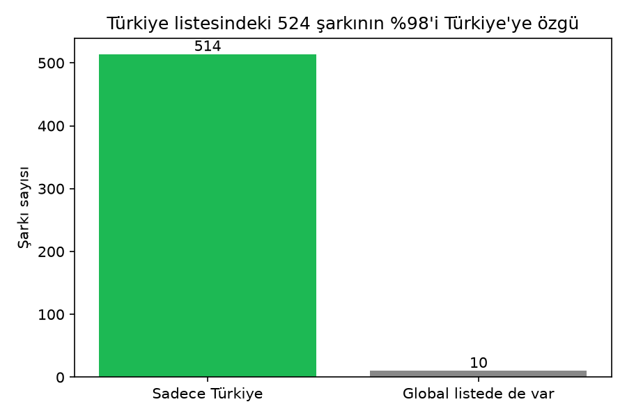
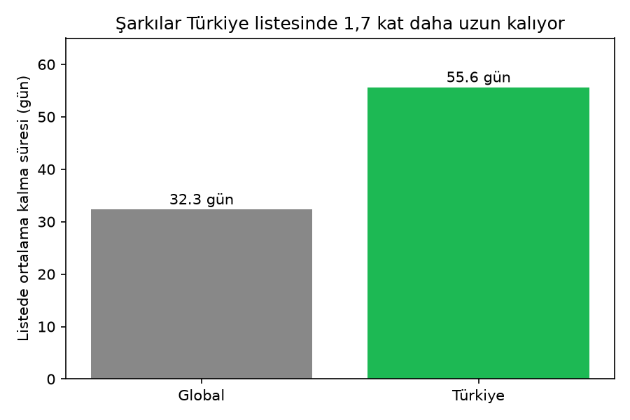
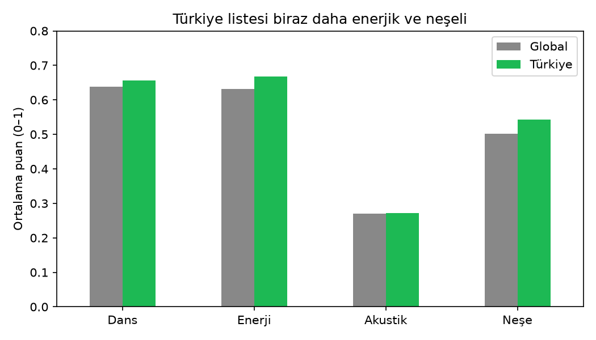
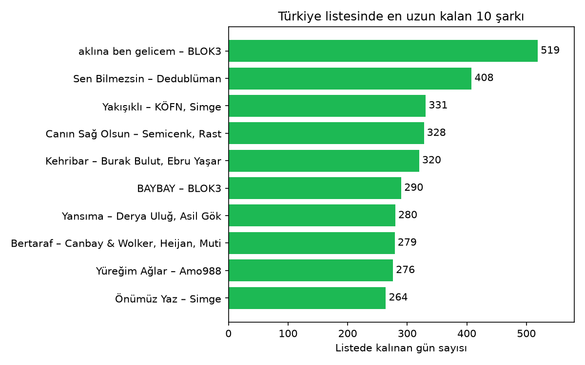

# Türkiye'de Ne Dinleniyor? Spotify Listeleri Analizi

Türkiye'nin Spotify Top 50 listesini global listeyle karşılaştıran bir veri analizi projesi. Yaklaşık 20 aylık günlük liste verisini Python ve SQL ile temizleyip analiz ederek tek bir soruya cevap aradım:

> **Türkiye'de dinlenen müzik dünyadan nasıl ayrılıyor?**

## Öne çıkan bulgular

- **%98 yerel:** Türkiye listesine giren 524 şarkının 514'ü global listede hiç yer almadı.
- **Daha kalıcı:** Bir şarkı Türkiye listesinde ortalama 55,6 gün, global listede 32,3 gün kalıyor (yaklaşık 1,7 kat).
- **Biraz daha enerjik ve neşeli:** Türkiye listesi; dans edilebilirlik, enerji ve neşe puanlarında globalin biraz önünde.
- **Uzun soluklu bir lider:** BLOK3'ün "aklına ben gelicem" şarkısı yaklaşık 580 günlük dönemin 519 gününde listede kaldı, ama hiç 1 numaraya çıkmadı.

## Veri

- **Kaynak:** [Top Spotify Songs in 73 Countries (Daily Updated)](https://www.kaggle.com/datasets/asaniczka/top-spotify-songs-in-73-countries-daily-updated), Kaggle, asaniczka (ODC Attribution License)
- **Kapsam:** 73 ülke ve global liste için günlük ilk 50 şarkı, 18 Ekim 2023 – 11 Haziran 2025
- **Boyut:** Yaklaşık 2,1 milyon satır, 25 sütun (şarkı, sanatçı, günlük sıra, tarih ve Spotify ses özellikleri)

Veri dosyası boyutu nedeniyle bu repoda yer almıyor; yukarıdaki bağlantıdan indirilebilir.

## Kullanılan araçlar

Python (pandas, matplotlib), SQL (SQLite), Jupyter Notebook, Git

## Yöntem

Proje, her biri tek bir işi yapan üç notebook'tan oluşuyor:

1. **[01_kesif.ipynb](notebooks/01_kesif.ipynb):** Veriyi tanıma. Satır ve sütun sayısı, veri tipleri, ülke dağılımı, tarih aralığı ve eksik değerler incelendi.
2. **[02_temizleme.ipynb](notebooks/02_temizleme.ipynb):** Veri temizleme.
   - Ülkesi boş olan 28.908 satır global liste olarak etiketlendi.
   - Metin olarak okunan tarih sütunları tarih tipine çevrildi.
   - Şarkı adı veya sanatçısı eksik olan 30 satır çıkarıldı.
   - Analiz için sadece Türkiye ve global satırları ayrıldı (58.017 satır) ve SQLite veritabanına yüklendi.
3. **[03_analiz.ipynb](notebooks/03_analiz.ipynb):** Dört sorunun SQL sorgularıyla cevaplanması ve görselleştirilmesi.

## Bulgular

### 1. Yerellik: Türkiye listesinin neredeyse tamamı yerel

Türkiye listesine 20 ay boyunca 524 farklı şarkı girdi; bunların yalnızca 10'u global listede de yer aldı. Ortak şarkılar "Die With A Smile", "APT." ve "Not Like Us" gibi dünya çapındaki hitler. Dikkat çekici bir istisna: Zeynep Bastık'ın "Lan" şarkısı global listeye girmeyi başardı.



### 2. Kalıcılık: Şarkılar Türkiye'de daha uzun kalıyor

Bir şarkı Türkiye listesinde ortalama 55,6 gün, global listede 32,3 gün kalıyor. Bu, Türkiye listesine neden daha az farklı şarkının girdiğini de açıklıyor (524'e karşı 896): Türkiye'nin listesi daha yavaş değişiyor.



### 3. Ses karakteri: Biraz daha enerjik ve neşeli

Her şarkı bir kez sayılarak Spotify'ın ses özelliklerinin ortalaması alındı. Türkiye listesi enerji (0,668'e karşı 0,632), neşe (0,542'ye karşı 0,501) ve dans edilebilirlikte (0,656'ya karşı 0,638) biraz önde; akustiklik ise neredeyse aynı. Farklar küçük olduğu için bu, belirgin bir ayrımdan çok hafif bir eğilim olarak yorumlanmalı.



### 4. Liderler: Uzun kalmak, zirveye çıkmakla aynı şey değil

Türkiye listesinde en uzun kalan şarkı BLOK3'ün "aklına ben gelicem"i (519 gün) hiç 1 numara olmadı. İlk 10'da 1 numarayı gören tek şarkı Derya Uluğ ve Asil Gök'ün "Yansıma"sı. İlk 10'un tamamı Türkçe; BLOK3 ve Simge ikişer şarkıyla listede.



## Sınırlılıklar

- Veri yalnızca Spotify kullanıcılarını yansıtıyor; Türkiye'deki diğer platformlar ve radyo dinlemeleri dahil değil.
- Veri setinde bazı günler eksik; her liste yaklaşık 580 günü kapsıyor.
- Aynı şarkının farklı sürümleri farklı Spotify kimlikleriyle listelenebiliyor; kontrolde bunun etkisinin çok küçük olduğu görüldü.
- Dönemin başında zaten listede olan ya da sonunda hâlâ listede olan şarkıların kalma süreleri, gerçek sürelerinden kısa ölçülmüş olabilir.

## Projeyi çalıştırma

```bash
git clone https://github.com/aslizynp/spotify-turkiye-analizi.git
cd spotify-turkiye-analizi
python -m venv venv
venv\Scripts\activate        # macOS/Linux: source venv/bin/activate
pip install -r requirements.txt
```

Ardından veri setini Kaggle'dan indirip `data/` klasörüne koyun ve notebook'ları sırayla (01, 02, 03) çalıştırın.

## Yazar

**Aslı Zeynep Çelen** · Bilgisayar Mühendisliği öğrencisi, Zonguldak Bülent Ecevit Üniversitesi
[LinkedIn](https://linkedin.com/in/aslı-zeynep-çelen) · [GitHub](https://github.com/aslizynp)
